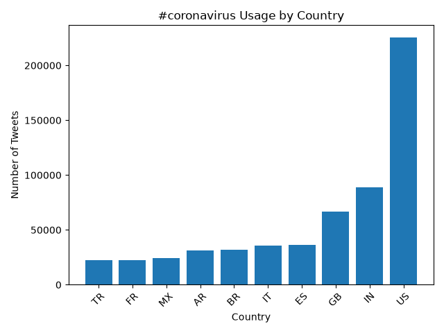
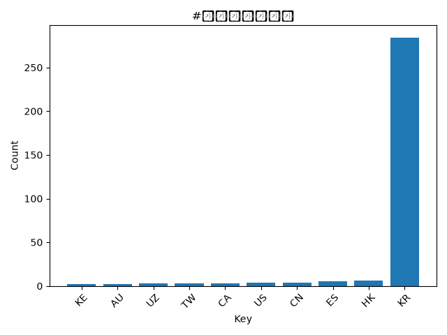
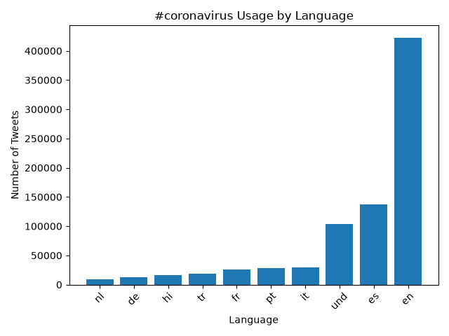
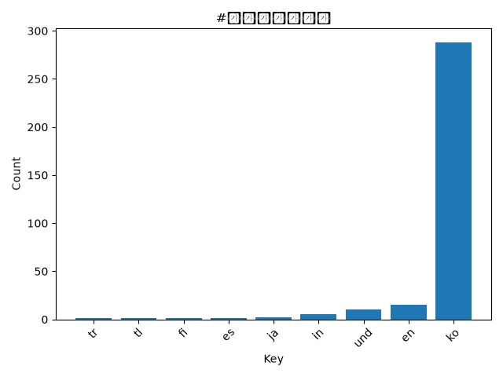
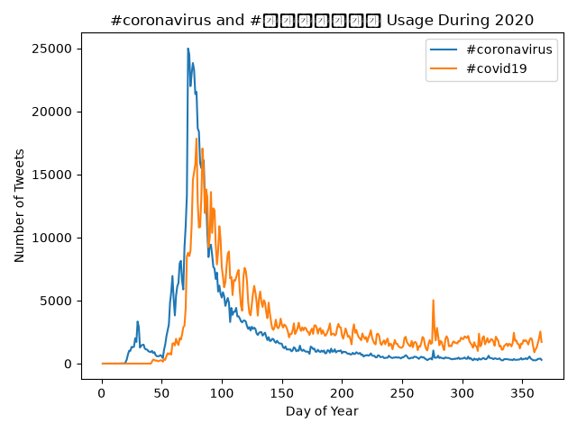

## Twitter Coronavirus MapReduce Project

This project uses the MapReduce model to analyze geotagged tweets sent in the year 2020. The purpose of the project is to track coronavirus-related hashtags on geotagged tweets. These are tracked based on language, country of origin, and time of year. 

## Step 1: MAP STEP
The first part of the MapReduce procedure is the mapping step. This is the filtering and sorting step. In our project, this step sorted all tweets from 2020 by day of the year. It then created two output files, one containing coronavirus-related hashtag counts by language, and another containing coronavirus-related hashtag counts by country.

## Step 2: REDUCE STEP
The reduce step combines all mapper outputs into yearly datasets. The first dataset contains all the daily language counts added together to create one language dataset. It then does the same for all daily country files. This summarizes hundreds of files into two, making it much easier for analysis.

## Step 3: VISUALIZATION STEP
The visualize.py script uses the newly reduced datasets to create bar graphs showing the top 10 languages and countries for the selected hashtags. 

The alternative_reduce.py script performs a separate reduction step across the daily mapper outputs. This time, a line graph showing how selected hashtag usage changed over the course of 2020.

## Visualizations

### #coronavirus by Country

### #코로나바이러스 by Country

### #coronavirus by Language

### #코로나바이러스 by Language

### Hashtag Usage Over Time

